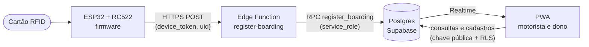
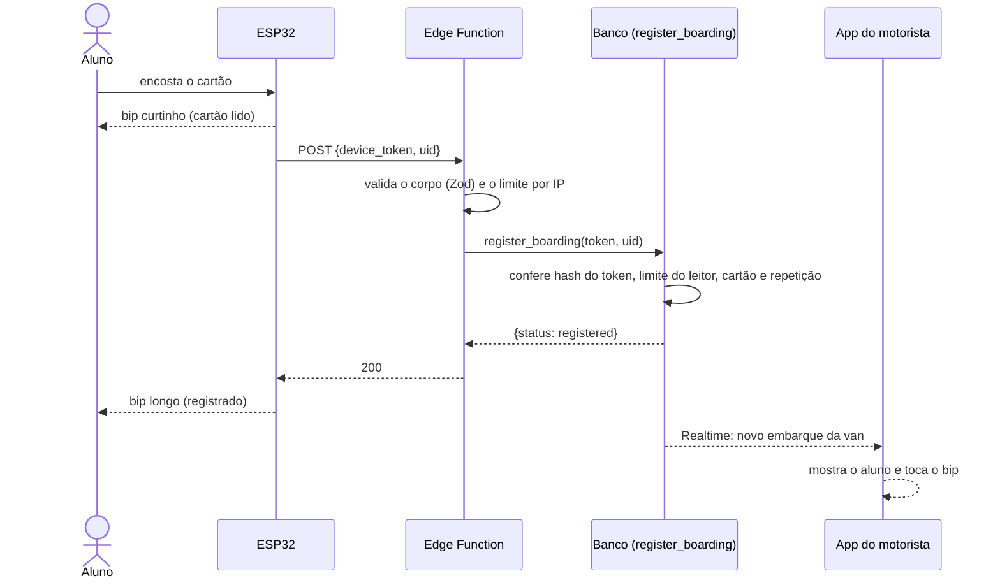
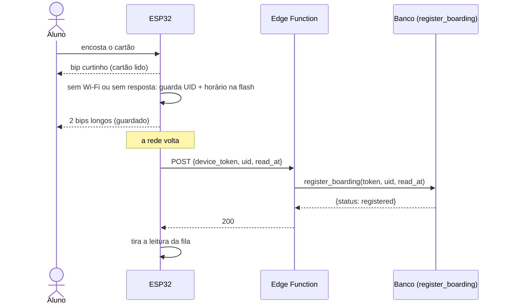
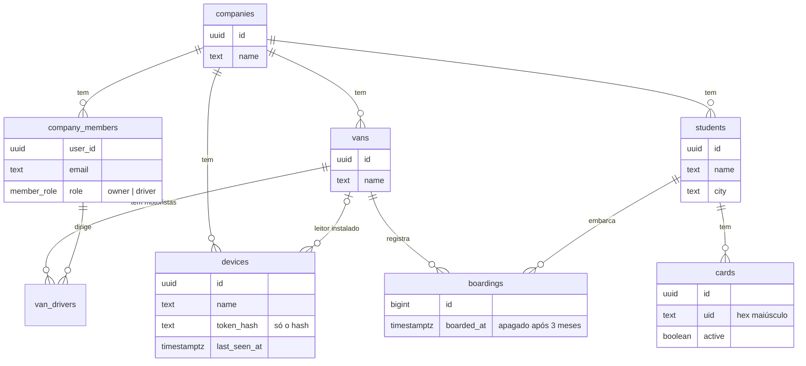
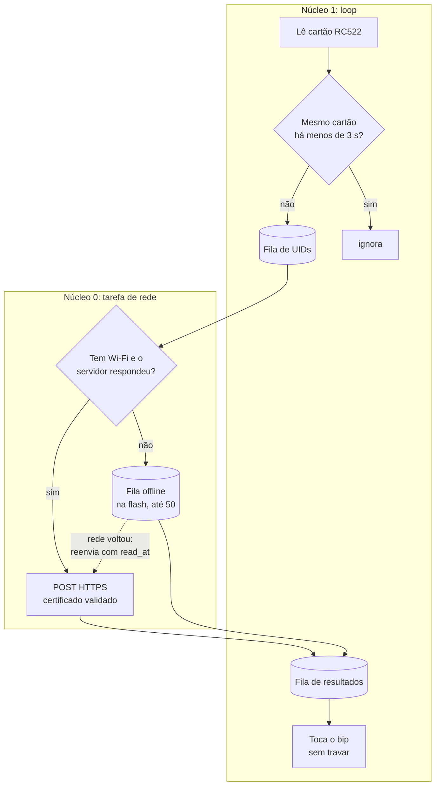

# Diagramas do BipCheck

Diagramas em [Mermaid](https://mermaid.js.org/): o GitHub mostra o desenho direto nesta página.

## Visão geral

## Um embarque, passo a passo

## Um embarque sem rede (regra local do leitor)

## Modelo de dados

A tabela `audit_logs` fica fora do diagrama. Ela registra quem fez o quê, em qual registro, e é apagada após 30 dias.

## Firmware

